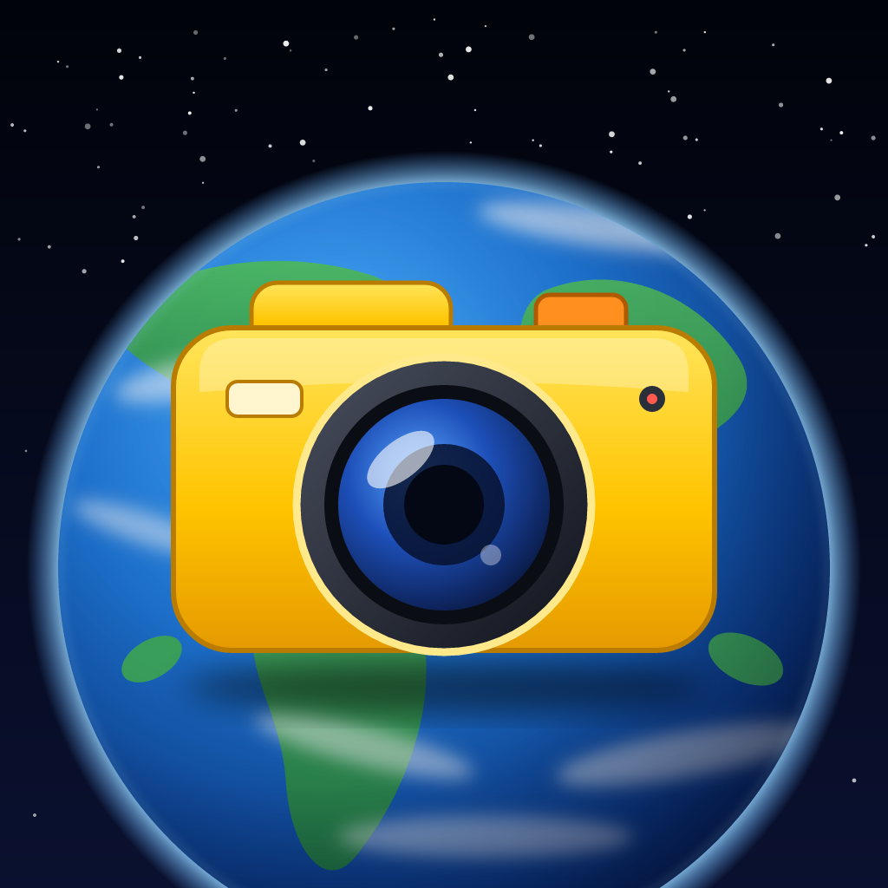
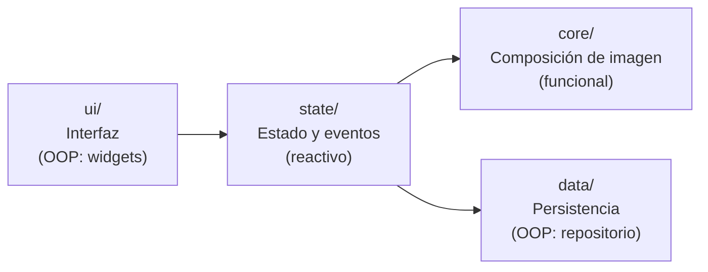
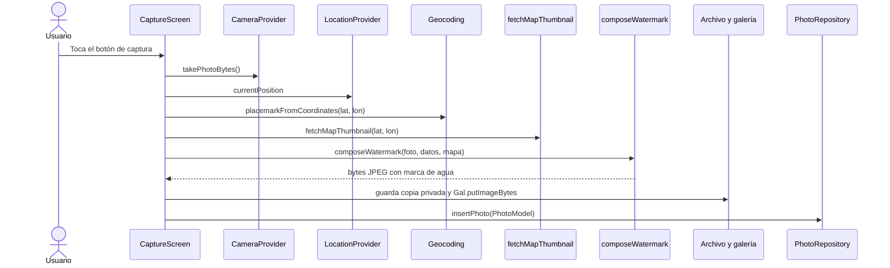

<p align="center">
  
</p>

<h1 align="center">GeoSnap</h1>

<p align="center">
  <strong>Fotos con marca de agua georreferenciada, sin anuncios y sin cuentas.</strong><br>
  Aplicación móvil multiplataforma desarrollada con Flutter para dejar constancia visual de dónde y cuándo ocurrió un momento.
</p>

<p align="center">
  
  
  
  
</p>

---

## Tabla de contenido

1. [Descripción](#descripción)
2. [Características](#características)
3. [Capturas de pantalla](#capturas-de-pantalla)
4. [Arquitectura y paradigmas](#arquitectura-y-paradigmas)
5. [Estructura del proyecto](#estructura-del-proyecto)
6. [Tecnologías](#tecnologías)
7. [Requisitos previos](#requisitos-previos)
8. [Instalación y ejecución](#instalación-y-ejecución)
9. [Permisos](#permisos)
10. [Cómo funciona una captura](#cómo-funciona-una-captura)
11. [Persistencia de datos](#persistencia-de-datos)
12. [Privacidad y servicios externos](#privacidad-y-servicios-externos)
13. [Solución de problemas](#solución-de-problemas)
14. [Limitaciones conocidas](#limitaciones-conocidas)
15. [Hoja de ruta](#hoja-de-ruta)
16. [Contexto académico](#contexto-académico)
17. [Autores](#autores)
18. [Licencia y créditos](#licencia-y-créditos)

---

## Descripción

Muchas actividades requieren probar **dónde** y **cuándo** se tomó una fotografía: una visita técnica, el registro de un hallazgo en campo, la documentación de un evento o, simplemente, recordar un lugar. Las aplicaciones de "cámara GPS" que resuelven esa necesidad suelen estar cargadas de publicidad, pedir suscripciones para funciones básicas o estar disponibles para un solo sistema operativo.

**GeoSnap** es una alternativa limpia. Toma la foto, obtiene la ubicación por GPS y estampa sobre la imagen una marca de agua con:

- un mini-mapa centrado en el punto exacto,
- la ciudad, región y país,
- la dirección completa y el código postal,
- las coordenadas (latitud y longitud),
- la fecha, la hora y la zona horaria.

La foto resultante se guarda en la galería del teléfono y se registra en una base de datos local, sin enviar nada a ningún servidor.

El proyecto nació como **proyecto integrador del curso de Paradigmas de Programación**, por lo que además de ser una aplicación funcional es un caso de estudio de cómo combinar paradigmas (orientado a objetos, funcional y reactivo) según la naturaleza de cada subproblema. Ver [Arquitectura y paradigmas](#arquitectura-y-paradigmas).

## Características

- **Vista de cámara en vivo** con las coordenadas actualizándose en tiempo real.
- **Marca de agua georreferenciada** compuesta directamente sobre los píxeles de la foto, de modo que no se puede separar de la imagen.
- **Mini-mapa real** de OpenStreetMap con pin en el punto exacto y atribución visible; si no hay internet, se usa un pin sobre fondo neutro.
- **Geocodificación inversa**: convierte las coordenadas en una dirección legible.
- **Doble guardado**: copia privada dentro de la app y copia en la galería pública del teléfono.
- **Galería propia**: cuadrícula de miniaturas, vista de detalle con zoom y datos de ubicación, y eliminación de fotos.
- **Sin anuncios, sin cuentas, sin analítica.** Los datos permanecen en el dispositivo.
- **Un solo código** para Android e iOS (la compilación para iOS aún no ha sido validada).

## Capturas de pantalla

> Agrega las capturas en `docs/screenshots/` con los nombres indicados.

| Cámara | Foto resultante | Galería |
| :---: | :---: | :---: |
|  |  |  |

## Arquitectura y paradigmas

La aplicación se organiza en **cuatro capas**. Cada una usa el paradigma que mejor resuelve su tipo de problema, y esa decisión es el eje del proyecto.



| Capa | Paradigma | Responsabilidad | Por qué ese paradigma |
| --- | --- | --- | --- |
| `ui/` | Orientado a objetos | Pantallas y widgets de Flutter | El framework modela la interfaz como un árbol de objetos que se componen. |
| `state/` | Reactivo | Flujo de posición GPS y ciclo de vida de la cámara | GPS y cámara son fuentes de eventos asíncronos; un `Stream` los expresa de forma natural y la interfaz se redibuja sola cuando cambian. |
| `core/` | Funcional | `composeWatermark`: foto + datos → foto nueva | Una función pura es fácil de razonar y de probar en aislamiento: mismas entradas, mismo resultado, sin efectos secundarios. |
| `data/` | Orientado a objetos | `PhotoRepository` y `PhotoModel` | El repositorio encapsula el acceso a SQLite; el resto de la app nunca habla con la base de datos directamente. |

### Función pura de composición

El corazón del proyecto es una función sin efectos secundarios: no toca la red, ni el disco, ni Flutter, y trabaja sobre una copia de la imagen para no mutar su entrada.

```dart
Uint8List composeWatermark({
  required Uint8List originalPhotoBytes,
  required double latitude,
  required double longitude,
  required String cityLine,
  required String addressLine,
  required DateTime takenAt,
  Uint8List? mapThumbnailBytes,
  String appName = 'GeoSnap',
})
```

`fetchMapThumbnail` (descarga del mapa) **no** es pura porque usa la red, por eso vive aparte y su resultado se pasa como parámetro. Así la parte funcional se mantiene aislada de los efectos.

## Estructura del proyecto

```text
geosnap_app/
├── android/                         # Proyecto Android nativo (permisos, Gradle)
├── ios/                             # Proyecto iOS (permisos en Info.plist)
├── assets/
│   └── images/                      # logo.png, icon_background.png, icon_foreground.png
├── docs/                            # Documento de investigación y capturas
├── lib/
│   ├── main.dart                    # Punto de entrada: registra providers y tema
│   ├── ui/                          # Capa de interfaz (OOP)
│   │   ├── capture_screen.dart      # Cámara, cabecera y footer
│   │   ├── gallery_screen.dart      # Cuadrícula de fotos guardadas
│   │   └── photo_detail_screen.dart # Foto completa con zoom y datos
│   ├── state/                       # Capa reactiva
│   │   ├── camera_provider.dart     # Ciclo de vida del CameraController
│   │   └── location_provider.dart   # Stream de posición GPS
│   ├── core/                        # Lógica de imagen
│   │   ├── watermark_composer.dart  # Función pura de la marca de agua
│   │   └── map_thumbnail.dart       # Descarga y recorte del mini-mapa
│   └── data/                        # Capa de persistencia (OOP)
│       ├── photo_model.dart         # Modelo de una foto guardada
│       └── photo_repository.dart    # Acceso a SQLite
├── pubspec.yaml
└── README.md
```

## Tecnologías

| Componente | Tecnología | Uso |
| --- | --- | --- |
| Framework y lenguaje | Flutter 3.47 (canal estable) y Dart 3.13 | Aplicación multiplataforma con un solo código base |
| Cámara | [`camera`](https://pub.dev/packages/camera) `^0.12.1` | Vista previa y captura |
| Ubicación | [`geolocator`](https://pub.dev/packages/geolocator) `^14.0.3` | Permisos y stream de posición en tiempo real |
| Geocodificación | [`geocoding`](https://pub.dev/packages/geocoding) `^5.0.0` | Coordenadas → dirección |
| Procesamiento de imagen | [`image`](https://pub.dev/packages/image) `^4.9.2` | Composición de la marca de agua |
| Red | [`http`](https://pub.dev/packages/http) | Descarga de tiles del mapa |
| Estado | [`provider`](https://pub.dev/packages/provider) `^6.1.5+1` | Inyección de dependencias y estado reactivo |
| Base de datos local | [`sqflite`](https://pub.dev/packages/sqflite) `^2.4.3` | Metadatos de cada foto |
| Archivos | [`path_provider`](https://pub.dev/packages/path_provider) `^2.1.6` y [`path`](https://pub.dev/packages/path) `^1.9.1` | Rutas de almacenamiento |
| Galería del sistema | [`gal`](https://pub.dev/packages/gal) `^2.3.3` | Guardar en la galería pública |
| Ícono de la app | [`flutter_launcher_icons`](https://pub.dev/packages/flutter_launcher_icons) (dev) | Generación del ícono de lanzador |
| Mapas | [OpenStreetMap](https://www.openstreetmap.org/) | Tiles del mini-mapa |

Entorno con el que se desarrolló y probó: Windows 10, Android SDK 36 (build-tools 36.0.0), NDK `28.2.13676358`, Gradle 9.3.1 y un dispositivo Android físico (Xiaomi).

## Requisitos previos

- [Flutter SDK](https://docs.flutter.dev/get-started/install) (canal estable).
- Android Studio con el **Android SDK**, las **Command-line Tools** y el **NDK** `28.2.13676358`.
- Un **dispositivo Android físico** con depuración USB. Se recomienda sobre el emulador porque la app depende de cámara y GPS reales.
- Conexión a internet para el mini-mapa y la dirección (la foto se puede tomar sin ella; ver [Limitaciones](#limitaciones-conocidas)).

Verifica el entorno con:

```bash
flutter doctor
```

> Para compilar solo para Android, los avisos de Chrome y Visual Studio de `flutter doctor` se pueden ignorar.

## Instalación y ejecución

1. **Clona el repositorio** en una ruta **sin tildes ni espacios** (ver [Solución de problemas](#solución-de-problemas)):

   ```bash
   git clone <URL-DEL-REPOSITORIO> D:\dev\geosnap_app
   cd D:\dev\geosnap_app
   ```

2. **Instala las dependencias:**

   ```bash
   flutter pub get
   ```

3. **Conecta el celular** por USB con la depuración activada y confirma que Flutter lo ve:

   ```bash
   flutter devices
   ```

4. **Ejecuta la app:**

   ```bash
   flutter run
   ```

   Durante la sesión: `r` recarga en caliente, `R` reinicia y `q` termina la sesión de forma limpia.

### Generar el ícono de la app

Con las tres imágenes en `assets/images/` y la sección `flutter_launcher_icons` de `pubspec.yaml`:

```bash
dart run flutter_launcher_icons
```

El ícono forma parte de la instalación: reinstala la app con `flutter run` (el hot reload no lo actualiza).

### Compilar una versión instalable

```bash
flutter build apk --release
```

El archivo queda en `build/app/outputs/flutter-apk/app-release.apk`.

## Permisos

### Android

En `android/app/src/main/AndroidManifest.xml`, antes de la etiqueta `<application>`:

```xml
<uses-permission android:name="android.permission.CAMERA" />
<uses-permission android:name="android.permission.ACCESS_FINE_LOCATION" />
<uses-permission android:name="android.permission.ACCESS_COARSE_LOCATION" />
<uses-permission android:name="android.permission.INTERNET" />
<uses-feature android:name="android.hardware.camera" android:required="true" />
```

`INTERNET` ya viene habilitado en las compilaciones de depuración, pero **debe declararse explícitamente para las de release**; sin él, el mini-mapa y la dirección no se descargarían en la versión final.

Los permisos de cámara y ubicación se solicitan al usuario la primera vez que la app los necesita.

### iOS

En `ios/Runner/Info.plist`:

```xml
<key>NSCameraUsageDescription</key>
<string>Esta app necesita la cámara para tomar fotos georreferenciadas.</string>
<key>NSLocationWhenInUseUsageDescription</key>
<string>Esta app necesita tu ubicación para georreferenciar tus fotos.</string>
<key>NSPhotoLibraryAddUsageDescription</key>
<string>Esta app necesita guardar tus fotos georreferenciadas en la galería.</string>
```

## Cómo funciona una captura



**El mini-mapa.** `fetchMapThumbnail` calcula qué tile de OpenStreetMap contiene la coordenada (proyección "slippy map", zoom 17), descarga un mosaico de 3×3 tiles alrededor, recorta un cuadrado centrado en el punto exacto, dibuja el pin y añade la atribución `© OpenStreetMap`.

**El texto.** Las fuentes bitmap del paquete `image` solo existen en tamaños fijos y no incluyen el símbolo `°`. Por eso el texto se mide carácter a carácter para ajustar el ancho, se renderiza en negrita sobre un lienzo transparente y el símbolo de grados se dibuja como un anillo.

## Persistencia de datos

Cada foto se registra en la tabla `photos` de la base de datos `geosnap.db`:

```sql
CREATE TABLE photos (
  id        INTEGER PRIMARY KEY AUTOINCREMENT,
  filePath  TEXT NOT NULL,   -- ruta del archivo en el almacenamiento privado de la app
  latitude  REAL NOT NULL,
  longitude REAL NOT NULL,
  address   TEXT,
  takenAt   TEXT NOT NULL    -- fecha y hora en formato ISO 8601
);
```

Ubicación en el dispositivo (almacenamiento privado, aislado por app):

```text
/data/data/com.example.geosnap_app/databases/geosnap.db
```

### Inspeccionar la base de datos

En una compilación de depuración puedes extraerla con `adb`:

```bash
adb shell "run-as com.example.geosnap_app cp databases/geosnap.db /sdcard/Download/geosnap.db"
adb pull /sdcard/Download/geosnap.db .
```

Ábrela con [DB Browser for SQLite](https://sqlitebrowser.org/) o con el **Database Inspector** de Android Studio (App Inspection).

## Privacidad y servicios externos

GeoSnap no tiene servidor propio, cuentas de usuario, analítica ni publicidad. Las fotos y sus metadatos permanecen en el dispositivo.

La app solo hace llamadas de red a dos servicios, y solo en el momento de la captura:

| Servicio | Qué se envía | Para qué |
| --- | --- | --- |
| Tiles de OpenStreetMap (`tile.openstreetmap.org`) | Los números de tile (zoom, x, y) cercanos a tu ubicación | Dibujar el mini-mapa |
| Geocodificador del dispositivo (vía `geocoding`) | Las coordenadas | Obtener la dirección |

Los tiles de OpenStreetMap se usan bajo su [política de uso](https://operations.osmfoundation.org/policies/tiles/), pensada para un uso ligero. Para un despliegue con mucho tráfico habría que usar un proveedor de tiles propio o comercial.

## Solución de problemas

Problemas reales encontrados al montar el entorno en **Windows 10**:

| Síntoma | Causa | Solución |
| --- | --- | --- |
| `Your project path contains non-ASCII characters` al compilar | Gradle falla si la ruta del proyecto tiene tildes o caracteres especiales | Mover el proyecto a una ruta simple como `D:\dev\geosnap_app` |
| `flutter doctor` marca "Android license status unknown" | Error conocido de Flutter con las Command-line Tools más recientes | Ignorarlo: no impide compilar |
| `Could not close incremental caches` en tareas `compileDebugKotlin` | Condición de carrera al compilar módulos Kotlin en paralelo | Agregar a `android/gradle.properties`: `kotlin.incremental=false`, `org.gradle.caching=false`, `org.gradle.parallel=false` |
| `Package ndk not found` y fallo de `sdkmanager` | Gradle no logra descargar el NDK automáticamente | Instalar el NDK `28.2.13676358` desde Android Studio → SDK Manager → SDK Tools |
| `INSTALL_FAILED_USER_RESTRICTED` en un Xiaomi | MIUI bloquea instalaciones por USB | Activar **Instalar mediante USB** en Opciones de desarrollador y aceptar el diálogo del teléfono |
| El emulador cierra con "Not enough space to create userdata partition" | Poco espacio libre en `C:` | Mover el SDK y los AVD a otra unidad (`ANDROID_HOME`, `ANDROID_AVD_HOME`) o usar un dispositivo físico |
| `placemarkFromCoordinates isn't defined` | En `geocoding` 5.x la API pasó a ser una instancia | Usar `Geocoding().placemarkFromCoordinates(...)` |
| La foto aparece en la galería como `..._jpg.jpg` | `gal` agrega la extensión por su cuenta | Pasar `name` **sin** `.jpg` a `Gal.putImageBytes` |
| Chrome y Visual Studio en rojo en `flutter doctor` | Son para web y escritorio | Ignorarlos: el proyecto es móvil |

Si tu SDK de Android no está en la ubicación por defecto, indícalo con:

```bash
flutter config --android-sdk "D:\Android\Sdk"
```

## Limitaciones conocidas

- **Internet para el mapa y la dirección.** Sin conexión la foto se guarda igual, pero con un pin simple en lugar del mapa y con "Ubicación desconocida" si el geocodificador no responde.
- **Resolución de captura.** Las fotos salen en 720×1280 (`ResolutionPreset.high`). Subirla exige reajustar los tamaños del texto, que están pensados para esa escala.
- **Vista previa parcial.** La cámara muestra solo las coordenadas; la marca de agua completa se compone al capturar.
- **Eliminar una foto** borra el registro y el archivo privado de la app, pero **no** la copia de la galería del sistema.
- **Fuentes bitmap.** Solo se dibujan los caracteres que la fuente incluye; no hay emojis ni banderas.
- **Cámara.** Usa la primera cámara disponible, sin flash, zoom ni selección de lente.
- **iOS** tiene los permisos configurados, pero no se ha compilado ni probado.
- **Pruebas automatizadas.** Aún no hay.

## Hoja de ruta

- [ ] Marca de agua superpuesta **en vivo** sobre la vista de la cámara, idéntica al resultado final.
- [ ] Encuadre 3:4 y mayor resolución de captura, con escalado proporcional de la marca de agua.
- [ ] Activar los espacios reservados de la interfaz: ajustes y plantillas de marca de agua.
- [ ] Pruebas unitarias de `composeWatermark` (por ser pura, es el mejor candidato).
- [ ] Compartir y exportar fotos desde la galería.
- [ ] Sincronización opcional con un servidor, para el caso de uso empresarial de seguimiento de visitas.
- [ ] Compilar y validar en iOS.

## Contexto académico

Proyecto integrador del curso **Paradigmas de Programación**.

**Pregunta de investigación:** ¿cómo diseñar e implementar una aplicación móvil multiplataforma, libre de publicidad, que permita georreferenciar fotografías mediante marca de agua, aplicando un enfoque multiparadigma acorde a la naturaleza de cada componente?

**Objetivo general:** diseñar e implementar una aplicación móvil multiplataforma, libre de publicidad, que permita georreferenciar fotografías mediante marca de agua digital, aplicando un enfoque multiparadigma (orientado a objetos, funcional y reactivo).

El planteamiento completo del problema (justificación, delimitación, viabilidad y componentes tecnológicos) está en [`docs/Proyecto_Integrador_Problema_Investigacion.docx`](docs/Proyecto_Integrador_Problema_Investigacion.docx).

## Autores

- **[Daniel Armando Cordoba Velez]** — [https://github.com/Dacknow]

Docente: [Magister Emersson Perez Duarte] · [Universidad Incca de Colombia]

## Licencia y créditos

**Licencia:** MIT License. Ver [`LICENSE`](LICENSE) para más detalles.

**Créditos**

- Datos de mapa © [colaboradores de OpenStreetMap](https://www.openstreetmap.org/copyright), disponibles bajo la licencia ODbL.
- Construido con [Flutter](https://flutter.dev) y los paquetes de código abierto listados en [Tecnologías](#tecnologías).
